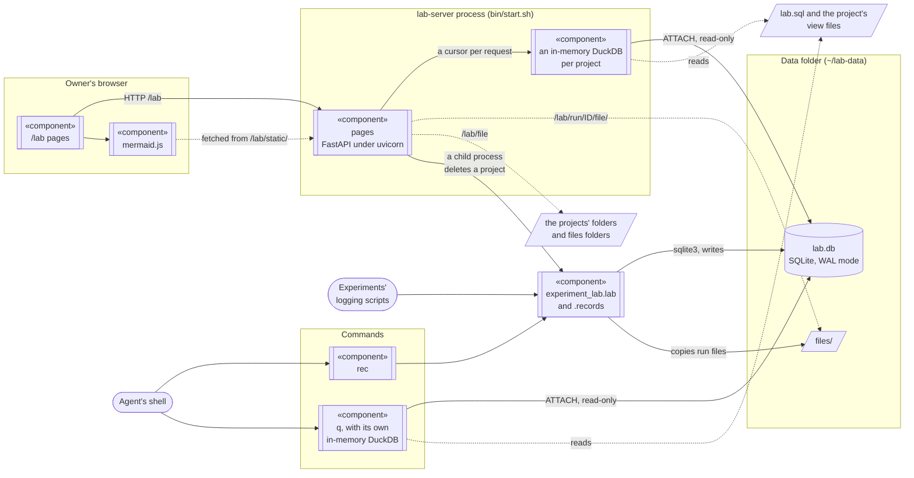

# experiment-lab

Experiments' runs, and the decisions, findings, protocol rules and open questions about them, for
several projects in one SQLite database, `lab.db`. A project's experiments form a tree: each one
below the experiment that led to it, with the project at the top. `q` answers questions about runs
and records with one DuckDB SQL query; `rec` adds and changes projects, experiments and records;
logging scripts write runs with the module `experiment_lab.lab`; pages at `/lab` show the records
with their evidence, the experiment tree with a search of its texts, the experiments and their runs,
the SQL views as tables, a read-only query box, the files under the projects' folders, every
project with a button that deletes one (Projects), and the version, repository and author of
experiment-lab (About, from `pyproject.toml`). The
Records, Experiments, Views and query, and Files pages show the project picked at the top of them;
the pages they link to show the same whatever is picked, and have no picker. A view's page shows the
view of the project whose query page linked it, its rows sorted by every column from the first, which
replaces an `ORDER BY` of the view; an experiment's page shows its runs latest first. A link to
the query box from the page of an experiment, a run or a record opens it on that item's project. It is meant
for a coding agent and a person working on the same experiments: the agent reads and writes with
`q` and `rec`, the person reads the pages.

## Installation

Each computer has a lab of its own: a database, the commands `q`, `rec` and `lab-server`, and the
pages at http://127.0.0.1:5000/lab. Installing has two parts, and both are needed:

- the package, which gives the commands and the pages' server, installed from a terminal;
- the Claude Code plugin, which holds only the skill `experiment-lab:experiment-db`: the agent's
  instructions for using the commands. It does not install them.

It needs Linux (`start.sh` uses `setsid` and `ionice`), git,
[uv](https://docs.astral.sh/uv/getting-started/installation/), and network access the first time q
or the pages read the database, when DuckDB downloads its SQLite reader.

1. In a terminal, install the commands and start the server:

   ```sh
   git clone https://github.com/dgutson/experiment-lab ~/experiment-lab
   uv tool install --editable ~/experiment-lab
   ~/experiment-lab/bin/start.sh
   ```

   uv puts the commands in `~/.local/bin`. If the shell does not find `rec`, `uv tool update-shell`
   adds that folder to the PATH of the terminals opened after it. The server runs in the background
   until the computer restarts; after a restart, run `~/experiment-lab/bin/start.sh` again.

2. Install the plugin, in a terminal:

   ```sh
   claude plugin marketplace add dgutson/experiment-lab
   claude plugin install experiment-lab@experiment-lab-marketplace
   ```

   or the same in Claude Code: `/plugin marketplace add dgutson/experiment-lab`, then
   `/plugin install experiment-lab@experiment-lab-marketplace`. A Claude Code session that was
   already running loads the plugin with `/reload-plugins`.

3. Make the project: optional. The first time the agent records something in a folder that no
   project holds, it makes the project there, with the name rec's message suggests (the folder's)
   and a description it writes. Make it yourself to choose the name, which cannot be changed later
   (the description can, with `--replace`). In a terminal, in the project's folder:

   ```sh
   cd ~/src/my-project
   rec project my-project --text "What the project is, in one line."
   ```

   Its folder is the main worktree of the git repository, else the current folder (see
   [Projects and the experiment tree](#projects-and-the-experiment-tree)).

The agent needs nothing in its prompt or settings: q and rec find the project from the folder it
works in. Open http://127.0.0.1:5000/lab to read what it files.

### Updating

In a terminal:

```sh
git -C ~/experiment-lab pull
claude plugin marketplace update experiment-lab-marketplace
claude plugin update experiment-lab@experiment-lab-marketplace
pkill -x lab-server; while pgrep -x lab-server > /dev/null; do sleep 1; done
~/experiment-lab/bin/start.sh
```

The install is editable, so q and rec run the pulled code at once, and lab-server after the restart
of the last two lines. The loop waits for the old server to end, since start.sh exits while one
answers. When the pull changes `pyproject.toml`, also run
`uv tool install --editable ~/experiment-lab --reinstall`. A Claude Code session that is running
loads the new plugin with `/reload-plugins`.

## Projects and the experiment tree

A project is an experiment with no parent. `rec project NAME --text "what the project is"`, run
once in the project's folder, makes it; its folder is the main worktree of the current git
repository, else the current folder (`--folder` sets another, `--folder .` the current folder). The
project of the current folder is the one whose folder holds it, or holds the folder at the same
place in the main worktree of its git repository, so that every worktree of a repository works in
the same projects. rec, q and `lab.py` work in that project, or in the one
named by `--project P` (`Lab(project="P")` in a script): q's views hold only its rows (`--all` reads
every project's), and rec and `lab.py` refuse another project's experiments, runs and records. A
script works in the project of its working folder, not of the folder the script is in. With no
project, q needs `--project` or `--all`, and rec and `lab.py` write nothing.

`rec experiment NAME --text "what it measures and why"` makes an experiment directly below the
project, or below an earlier experiment with `--in PARENT`; given again, `--in` moves it with the
experiments below it. `--dead-end` marks an idea that failed, which keeps its runs and records so
the reason can be found (a finding says why); `--no-dead-end` clears the mark. `rec tree` prints
the project's experiments, one indented line each, with `[dead end]` after those marked so;
`rec tree EXPERIMENT`, only those below EXPERIMENT. Experiment names are unique across the lab, so
a new experiment or project needs a name no experiment has: `rec experiment` and `rec project`
refuse to give an existing one a description other than its own unless `--replace`
(`replace=True` in Python), and an experiment of another project is refused.

The Experiments page shows the tree with, for each experiment, its records, when its first run
started (with no runs, when it was made), its processing duration (the sum of its runs' durations)
and its clock duration (the time during which at least one of its runs was running, shorter when
runs ran at the same time). Both say "not timed" when no run has a duration, and "running" while a
run has not ended. The project's row covers all its experiments. A run measures its duration only
when it is opened before the work starts, as a `with lab.run(...)` block around the work does, or
`rec run` before work that runs elsewhere (below).

The Projects page lists every project, whatever the picker shows: when it was made, its description,
its folder and the number of experiments below it and of their runs and records. Its Delete button
asks first, in a dialog whose default button is Cancel, then deletes from `lab.db` the project, the
experiments below it and their runs, with their params, tags, metrics and files, and records, and
removes the runs' folders from `files/` in the data folder. The project's folder, files folder and
view files are not touched, and nothing can bring the project back. lab-server runs the delete in
a child process, since it reads `lab.db` only through DuckDB, and refuses it unless the request
comes from its own page: the `Host` must be `127.0.0.1` or `localhost` and the `Origin` that same
address, since a page of any website can post a form to `127.0.0.1`.

## Records

A record is a row of the table `records`: an id, the experiment it is filed in (the project itself
for a record that no experiment fits, with `rec add --in PROJECT`), the label it is shown under (the experiment's name unless given), a kind (decision, finding, protocol or question),
a title, a text in Markdown, an author, a status (open, closed or superseded), the question it
answers, and its evidence: items `run:<run id>`, `file:<path>`, `sql:<query over the views>` or
`record:<id>`, joined by `; `, the run or record existing. rec warns about a `file:` item in a linked git worktree, where a
later checkout can change the file; such a file is logged in a run and cited as `run:<run id>`. A
new question is open and any other record closed unless a status is given, and a record that answers
an open question closes it. `rec add` and `rec set` print the record they changed and how many of
the project's records are open; `rec open` lists them. The view `records` has one row per record, with its project, and the
label as its column `experiment`. `--text -` (of `rec add`, `rec experiment` and `rec project`)
reads the text from stdin, without its last line breaks, so a quoted heredoc
(`--text - <<'EOF'`) or a file (`--text - < notes.md`) needs no escaping.

A record's page links each item of its evidence to its page or file, and shows the rows of a `sql:`
item. An item of no kind, which rec refuses but `lab.db` may hold, is shown as a `file:` item when it
is a `~/` or absolute path, as a link when it is an `http(s)` URL, and as text otherwise.

## Searching

The view `texts` has one row per experiment, run and record: its kind, id, project, experiment,
title and text. An experiment's text is its description; a run's is its note, then its params and
tags as `key=value` lines; a record's is its text. The search box on the Experiments page lists
those of the picked project whose title or text holds every word searched for, in any letter case;
with "only below" checked, only those of the experiment selected in the tree and the experiments
below it. A search holds at most 200 characters, and a query in the query box at most 5000. An
agent searches the same view with q:

```sh
q "SELECT kind, id, experiment, title FROM texts WHERE contains(lower(title || ' ' || text), 'sample rate')"
```

So that the search finds them, a new experiment needs a description (what it measures and why) and
a record a text; `rec`, `lab.py` and `records.py` refuse one without. A run's note is optional.

## Architecture

| Path | What it is |
|---|---|
| `experiment_lab/` | the package; its `__init__.py` lists what each module holds |
| `experiment_lab/schema.sql` | the tables of `lab.db` |
| `experiment_lab/lab.sql` | the views `experiments`, `runs`, `files`, `records` and `texts`, which q and the pages query |
| `experiment_lab/lab.py` | logging projects, experiments and runs from Python, with the standard library only |
| `bin/start.sh` | starts the pages' server, `lab-server`, in the background |
| `checks/check_pages.py` | opens every page of a running server and checks it |
| `checks/check_views.py`, `checks/sqlite_filter_bug.py` | checks to run before changing the DuckDB version |
| `checks/check_commands.py` | runs the commands on a new lab and compares what they print with `checks/check_commands.txt` |
| `checks/make_scratch.py` | makes a lab with data in it, for the checks and for trying changes |
| `evals/` | the skill's eval cases, and `run.sh`, which runs them |
| `plugin/` | a Claude Code plugin holding the skill `experiment-db`, which tells the agent how to use q, rec and `lab.py` |



There is one database of record, `lab.db`. The DuckDB databases hold no data, only the views over
it.

| Database | Engine | Where | Written by | Read by | Lasts |
|---|---|---|---|---|---|
| `lab.db` | SQLite, WAL mode | data folder | `experiment_lab.lab` and `experiment_lab.records`, with Python's sqlite3: rec, the logging scripts, and lab-server's child process that deletes a project | q and the pages, through DuckDB | always |
| the pages' databases, one per project, and one of every project for the pages of an experiment, a run or a record and the Projects page | DuckDB, in memory | the lab-server process | the pages: `lab.db` attached read-only as the catalog `lab`, then the views of `lab.sql` and of the project's view files | the pages, a cursor per request, with file access off | until `lab.sql`, one of the project's view files or its list of them changes |
| q's database | DuckDB, in memory | q's process | q: `lab.db` attached read-only as the catalog `lab`, then the views of `lab.sql` and of the project's view files (with `--all`, lab.sql's alone, over every project) | the SQL given to q | one q call |

Several processes may write at once and no server is needed for it: each write is one short
transaction that starts with `BEGIN IMMEDIATE` and waits up to 60 s for another writer to finish.
In WAL mode readers do not block writers and see only finished transactions.

DuckDB reads `lab.db` through its own copy of SQLite, which it downloads once as its
`sqlite_scanner` extension into `~/.duckdb/extensions/`. Two copies of SQLite in one process do not
see each other's locks (https://www.sqlite.org/howtocorrupt.html, section 2.2.1), so no process
opens `lab.db` with both: the writers use only Python's sqlite3, and q and the pages only DuckDB.
That is why lab-server makes a missing `lab.db` in a child process.

## The skill's evals

`evals/` holds eval cases for the skill, outside `plugin/` so that an installed plugin does not
copy them. In each case, an agent given the plugin, and one without it, does a task in a small lab
of its own (`evals/make_lab.py`), and graders check the commands it ran, what rec printed and what
it answered. `evals/run.sh` runs them with this clone's code through `claude plugin eval`, which
takes the options given (for example `--case dead-end --runs 1 --model sonnet`), and puts the
results in `evals/results/`. `evals/baseline.md` has the last full run's scores and costs.

## Logging runs from Python

`experiment_lab/lab.py` uses only Python's standard library, so a logging script imports it from
any Python 3.12 without installing anything: `PYTHONPATH=~/experiment-lab python3 script.py`.

```python
from experiment_lab.lab import Lab

lab = Lab()                                       # $EXPERIMENT_LAB_DATA, else ~/lab-data
lab.project("my-project", "What the project is.")  # once, from the project's folder
lab.experiment("rate test", "What it measures and why.")       # parent="..." to put it below another
with lab.run("rate test", "run 1", params={"rate": 48000}, note="Markdown") as run:
    run.log_metrics({"accuracy": 0.91}, step=3)   # every value is kept, with its step and time
    run.set_tags({"outcome": "pass"})
    run.log_file("plot.png")                      # copied to files/<run id>/plot.png
```

A run ends FINISHED when its `with` block ends, FAILED on an exception and KILLED on Ctrl-C; without
a `with` block, call `run.end()`.

Work that runs outside the Python that logs it, such as a background job, another tool or a person,
is timed by a run opened before it starts and ended by another process. `rec run EXPERIMENT NAME
[--note T] [--start T]` starts the run and prints its id. When the work ends, a script logs its
params, metrics and files through `lab.run_by_id(run_id)`, which refuses an id that is no run of the
lab's project, and calls `run.end()`; or `rec end RUN [--status FINISHED|FAILED|KILLED]
[--at T]` ends it. `run.end(at=ms)` and `--at` give an end earlier than now; `rec end` refuses a run
that has ended and an end before the run's start.

To record a decision or finding from a script, `experiment_lab.records.add` does what `rec add`
does.

## The data folder and a project's settings

The lab's files are in the data folder, `$EXPERIMENT_LAB_DATA` (default `~/lab-data`): `lab.db`,
the runs' files in `files/`, and start.sh's `server.log`. start.sh serves the pages on port
`$EXPERIMENT_LAB_PORT` (default 5000) and exits at once if a server already answers there. There is
no stop command: kill the `lab-server` process, which outlives the shell that started it. `lab.db` and its tables
are made by the first program that writes, and by lab-server when it starts.

A project's settings are in its row of `lab.experiments`, and `rec project NAME` changes those
given:

- `--folder F`: the project's folder, which tells rec, q and `lab.py` which project they are in.
- `--files F`: the folder the Files page opens, by default the project's folder.
- `--views FILE ...`: the project's view files, run after `lab.sql` in this order; `--views` alone
  clears them.

Paths may start with `~`; others are taken relative to the current folder. Each project has its own
DuckDB database in the pages and in q, so two projects may have views of the same name. q reads the
view files each time it runs, the pages whenever one changes. A statement of a view file that fails
is skipped: q prints its error on stderr, and the pages show it on the Records page and above the
list of views.

A view file holds DuckDB `CREATE VIEW` statements over the views of `lab.sql` and the tables of
`lab.db` in the catalog `lab` (`lab.experiments`, `lab.runs`, `lab.params`, `lab.tags`,
`lab.metrics`, `lab.files`, `lab.records`). In a project's database the views of `lab.sql` hold only
that project's rows, whose name `current_project()` returns, and the tables every project's;
`data_folder()` returns the data folder's absolute path, which the view `files` uses for each
logged file's `path`. The tables keep times as milliseconds since 1970; the views' `created`,
`time`, `started` and `ended` are local time to the minute, as `2026-08-31 21:03`, which
`local_time(ms)` writes. For example:

```sql
-- One row per finished run of "rate test", with its accuracy.
CREATE VIEW accuracy AS SELECT name, metrics['accuracy'] AS accuracy
    FROM runs WHERE experiment = 'rate test' AND status = 'FINISHED';
```

## Diagrams

Record texts, notes, descriptions and `.md` files are shown as Markdown, and their
```` ```mermaid ```` blocks are drawn as diagrams in the browser by mermaid.js 11.17.2. The pages
fetch it from the package itself (`experiment_lab/static/`, with its MIT license), so no diagram text
leaves the computer and the server needs no Node. 11.17.2 is the version mermaid-cli 11.16.0 uses,
so `mmdc -i x.mmd -o x.svg` checks a diagram the way the pages draw it. A diagram that does not
parse shows Mermaid's error above its text.

To change the version, take `package/dist/mermaid.min.js` and `package/LICENSE` from
`npm pack mermaid@VERSION`, store them as `experiment_lab/static/mermaid-VERSION.min.js` and
`mermaid-VERSION.LICENSE`, and change the file name in `experiment_lab/templates/lab/base.html`.

## Files

`/lab/file?path=P` shows the file or folder P, a `~/` or absolute path, when it is under a project's
folder or files folder, and answers 404 for anything else. A folder is shown as a list of its files,
a `.md` file as Markdown (`&raw=1` for its text), an HTML file with scripts off, a text file as plain
text, and any other file as it is. The pages link to `/lab/file` each `file:` item of a record and
each `~/` or absolute path in a Markdown text, also one that is all of a code span, when
`/lab/file` serves it; a relative path is not linked. On a record's page, a folder's page and a
run's page, an audio file has a player next to its link, which fetches nothing until it plays, and
an image is shown next to its link.

## Checking the pages

```sh
uv run --script ~/experiment-lab/checks/check_pages.py [--shots FOLDER] [URL]
```

It opens every page of the server at URL (default `http://127.0.0.1:$EXPERIMENT_LAB_PORT`) and fails
unless each returns 200 and only the four pages of the picked project show the picker. It visits the
pages of every project, picking each with the cookie the project picker sets. It then opens the
pages with diagrams, audio players or images, and the first page of each kind, in the installed
Google Chrome, in the light and the dark scheme, and checks that each diagram is drawn or shows
Mermaid's error, each player loads its audio, each image shows, the page follows the scheme and
fetches nothing from another host. With `--shots`, it saves screenshots of the pages with diagrams.

## Changing the DuckDB version

DuckDB is pinned in `pyproject.toml`, `checks/check_views.py` and `checks/sqlite_filter_bug.py`. Set the
new version in the two scripts first and run both while nothing is logged to the lab:

```sh
cd ~/experiment-lab && uv run --script checks/check_views.py && uv run --script checks/sqlite_filter_bug.py
```

check_views.py must end with "the two reads agree" and sqlite_filter_bug.py must say "fixed". Then
set the version in `pyproject.toml`, run `uv lock`, and reinstall:
`uv tool install --editable ~/experiment-lab --reinstall`.
