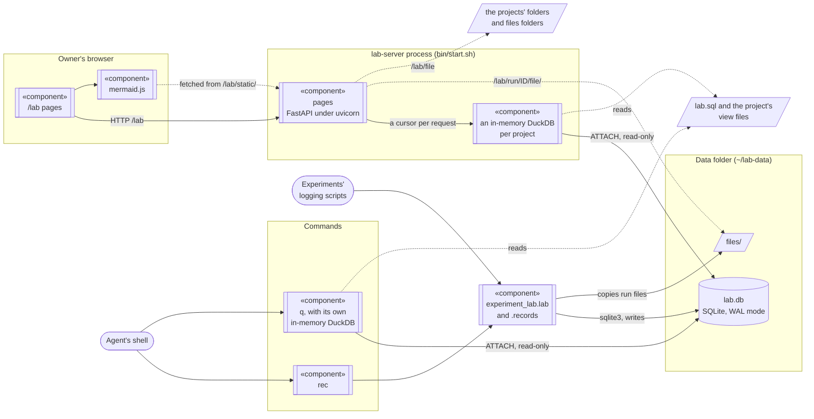

# experiment-lab

Experiments' runs, and the decisions, findings, protocol rules and open questions about them, for
several projects in one SQLite database, `lab.db`. A project's experiments form a tree: each one
below the experiment that led to it, with the project at the top. `q` answers questions about runs
and records with one DuckDB SQL query; `rec` adds and changes projects, experiments and records;
logging scripts write runs with the module `experiment_lab.lab`; pages at `/lab` show, for the
project picked at the top, the records with their evidence, the experiment tree with a search of
its texts, the experiments and their runs, the SQL views as tables, a read-only query box and the
files under the projects' folders. It is meant for a coding agent and a person working on the same
experiments: the agent reads and writes with `q` and `rec`, the person reads the pages.

| Path | What it is |
|---|---|
| `experiment_lab/` | the package; its `__init__.py` lists what each module holds |
| `experiment_lab/schema.sql` | the tables of `lab.db` |
| `experiment_lab/lab.sql` | the views `experiments`, `runs`, `records` and `texts`, which q and the pages query |
| `experiment_lab/lab.py` | logging projects, experiments and runs from Python, with the standard library only |
| `bin/start.sh` | starts the pages' server, `lab-server`, in the background |
| `bin/check_pages.py` | opens every page of a running server and checks it |
| `bin/check_views.py`, `bin/sqlite_filter_bug.py` | checks to run before changing the DuckDB version |
| `plugin/` | a Claude Code plugin holding the skill `experiment-db`, which tells the agent how to use q, rec and `lab.py` |

The commands, installed with the package: `q`, `rec`, `lab-server` and `lab-from-mlflow`.

## Projects and the experiment tree

A project is an experiment with no parent. `rec project NAME --text "what the project is"`, run
once in the project's folder, makes it; its folder is the main worktree of the current git
repository, else the current folder (`--folder` sets another). The project of the current folder is
the one whose folder holds it, or holds the main worktree of its git repository, so that every
worktree of a repository shares one project. rec, q and `lab.py` work in that project, and from a
project's folder they refuse another project's experiments.

`rec experiment NAME --text "what it measures and why"` makes an experiment directly below the
project, or below an earlier experiment with `--in PARENT`; given again, `--in` moves it with the
experiments below it. `--dead-end` marks an idea that failed, which keeps its runs and records so
the reason can be found (a finding says why); `--no-dead-end` clears the mark. `rec tree` prints
the project's experiments, one indented line each, with `[dead end]` after those marked so.
Experiment names are unique across the lab.

The Experiments page shows the tree with, for each experiment, its records, when its first run
started (with no runs, when it was made), its processing duration (the sum of its runs' durations)
and its clock duration (the time during which at least one of its runs was running, shorter when
runs ran at the same time). Both say "not timed" when no run has a duration, and "running" while a
run has not ended. The project's row covers all its experiments. A run measures its duration only when it is opened before the work starts, as a
`with lab.run(...)` block around the work does.

## Records

A record is a row of the table `records`: an id, the experiment it is filed in, the label it is
shown under (the experiment's name unless given), a kind (decision, finding, protocol or question),
a title, a text in Markdown, an author, a status (open, closed or superseded), the question it
answers, and its evidence: items `run:<run id>`, `file:<path>`, `sql:<query over the views>` or
`record:<id>`, joined by `; `. A new question is open and any other record closed unless a status is
given, and a record that answers an open question closes it. The view `records` has one row per
record, with its project, and the label as its column `experiment`.

A record's page links each item of its evidence to its page or file, and shows the rows of a `sql:`
item. lab-from-mlflow copies mlflow-lab's evidence, which may be any text, as it is; the page shows
such an item that is a `~/` or absolute path as a `file:` item, an `http(s)` URL as a link, and
anything else as text.

## Searching

The view `texts` has one row per experiment, run and record: its kind, id, project, experiment,
title and text. An experiment's text is its description; a run's is its note, then its params and
tags as `key=value` lines; a record's is its text. The search box on the Experiments page lists
those of the picked project whose title or text holds every word searched for, in any letter case;
with "only below" checked, only those of the experiment selected in the tree and the experiments
below it. An agent searches the same view with q:

```sh
q "SELECT kind, id, experiment, title FROM texts WHERE project = 'my-project' AND contains(lower(title || ' ' || text), 'sample rate')"
```

So that the search finds them, a new experiment needs a description (what it measures and why) and
a record a text; `rec`, `lab.py` and `records.py` refuse one without. A run's note is optional.

## Architecture



There is one database of record, `lab.db`. The DuckDB databases hold no data, only the views over
it.

| Database | Engine | Where | Written by | Read by | Lasts |
|---|---|---|---|---|---|
| `lab.db` | SQLite, WAL mode | data folder | `experiment_lab.lab` and `experiment_lab.records`, with Python's sqlite3: rec, the logging scripts, lab-from-mlflow | q and the pages, through DuckDB | always |
| the pages' databases, one per project | DuckDB, in memory | the lab-server process | the pages: `lab.db` attached read-only as the catalog `lab`, then the views of `lab.sql` and of the project's view files | the pages, a cursor per request, with file access off | until `lab.sql`, one of the project's view files or its list of them changes |
| q's database | DuckDB, in memory | q's process | q: `lab.db` attached read-only as the catalog `lab`, then the views of `lab.sql` and of the project's view files | the SQL given to q | one q call |

Several processes may write at once and no server is needed for it: each write is one short
transaction that starts with `BEGIN IMMEDIATE` and waits up to 60 s for another writer to finish.
In WAL mode readers do not block writers and see only finished transactions.

DuckDB reads `lab.db` through its own copy of SQLite, which it downloads once as its
`sqlite_scanner` extension into `~/.duckdb/extensions/`. Two copies of SQLite in one process do not
see each other's locks (https://www.sqlite.org/howtocorrupt.html, section 2.2.1), so no process
opens `lab.db` with both: the writers use only Python's sqlite3, and q and the pages only DuckDB.
That is why lab-server makes a missing `lab.db` in a child process.

## Setting up a computer

It needs Linux (start.sh uses `setsid` and `ionice`), [uv](https://docs.astral.sh/uv/), and network
access the first time q or the pages read the database, when DuckDB downloads its SQLite reader.

```sh
git clone https://github.com/dgutson/experiment-lab ~/experiment-lab
uv tool install --editable ~/experiment-lab
~/experiment-lab/bin/start.sh
cd ~/src/my-project
rec project my-project --text "What the project is, in one line."
rec experiment "rate test" --text "What it measures."
rec add question "Which sample rate do we keep?" --in "rate test" --text "..."
q "SELECT id, kind, status, title FROM records"
```

Then open http://127.0.0.1:5000/lab. `lab.db` and its tables are made by the first program that
writes, and by lab-server when it starts.

The install is editable, so a change to the clone's Python, templates or views needs no reinstall:
q and rec read it at once, and lab-server after a restart (a change to `lab.sql` or a view file
shows without one). After changing `pyproject.toml`, reinstall with
`uv tool install --editable ~/experiment-lab --reinstall`.

For a Claude Code agent, install the plugin `experiment-lab`:

```sh
claude plugin marketplace add dgutson/experiment-lab
claude plugin install experiment-lab@experiment-lab-marketplace
```

Its skill, `experiment-lab:experiment-db`, runs `q` and `rec` from the PATH, which find the project
from the current folder, so it needs no editing.

`evals/` holds eval cases for the skill, outside `plugin/` so that an installed plugin does not
copy them. In each case, an agent given the plugin, and one without it, does a task in a small lab
of its own (`evals/make_lab.py`), and graders check the commands it ran, what rec printed and what
it answered. `bin/evals.sh` runs them with this clone's code through `claude plugin eval`, which
takes the options given (for example `--case dead-end --runs 1 --model sonnet`), and puts the
results in `evals/results/`. `evals/baseline.md` has the last full run's scores and costs.

## Logging runs from Python

`experiment_lab/lab.py` uses only Python's standard library, so a logging script imports it from
any Python 3.12 without installing anything: `PYTHONPATH=~/experiment-lab python3 script.py`.

```python
from experiment_lab.lab import Lab

lab = Lab()                                       # $EXPERIMENT_LAB_DATA, else ~/lab-data
lab.project("my-project", "What the project is.")  # once, from the project's folder
lab.experiment("rate test", "What it measures and why.")       # parent="..." to put it below another
with lab.run("rate test", "run 1", params={"rate": 48000}, note="Markdown") as run:
    run.log_metrics({"accuracy": 0.91}, step=3)   # every value is kept, with its step and time
    run.set_tags({"outcome": "pass"})
    run.log_file("plot.png")                      # copied to files/<run id>/plot.png
```

A run ends FINISHED when its `with` block ends, FAILED on an exception and KILLED on Ctrl-C; without
a `with` block, call `run.end()`. A script that logged with MLflow changes these calls:

| MLflow | experiment-lab |
|---|---|
| `mlflow.set_experiment(name)` | `lab.experiment(name, description)` |
| `mlflow.start_run(run_name=n)` | `lab.run(experiment, n)` |
| `mlflow.log_param(s)` | `run.log_params({...})` |
| `mlflow.log_metric(s)(..., step=s)` | `run.log_metrics({...}, step=s)` |
| `mlflow.set_tag(s)` | `run.set_tags({...})` |
| `mlflow.log_artifact(path)` | `run.log_file(path)` |

To record a decision or finding from a script, `experiment_lab.records.add` does what `rec add`
does.

## The data folder and a project's settings

The lab's files are in the data folder, `$EXPERIMENT_LAB_DATA` (default `~/lab-data`): `lab.db`,
the runs' files in `files/`, and start.sh's `server.log`. start.sh serves the pages on port
`$EXPERIMENT_LAB_PORT` (default 5000) and exits at once if a server already answers there. There is
no stop command: kill the `lab-server` process, which outlives the shell that started it.

A project's settings are in its row of `lab.experiments`, and `rec project NAME` changes those
given:

- `--folder F`: the project's folder, which tells rec, q and `lab.py` which project they are in.
- `--files F`: the folder the Files page opens, by default the project's folder.
- `--views FILE ...`: the project's view files, run after `lab.sql` in this order; `--views` alone
  clears them.

Paths may start with `~`; others are taken relative to the current folder. Each project has its own
DuckDB database in the pages and in q, so two projects may have views of the same name. q reads the
view files each time it runs, the pages whenever one changes. A statement of a view file that fails
is skipped: q prints its error on stderr, and the pages show it on the Records page and above the
list of views.

A view file holds DuckDB `CREATE VIEW` statements over the views of `lab.sql` and the tables of
`lab.db` in the catalog `lab` (`lab.experiments`, `lab.runs`, `lab.params`, `lab.tags`,
`lab.metrics`, `lab.records`). The views of `lab.sql` hold every project's rows; their column
`project` tells them apart. For example:

```sql
-- One row per finished run of "rate test", with its accuracy.
CREATE VIEW accuracy AS SELECT name, metrics['accuracy'] AS accuracy
    FROM runs WHERE experiment = 'rate test' AND status = 'FINISHED';
```

## Moving from mlflow-lab

`lab-from-mlflow OLD_DATA_FOLDER PROJECT --text DESCRIPTION [--folder FOLDER]` copies a data folder
of mlflow-lab, where an MLflow server kept the runs and records in `mlflow.db`, into a new `lab.db`
in `$EXPERIMENT_LAB_DATA` (default `~/lab-data`), which must have none yet. The experiments go
directly below a new project, PROJECT, whose files folder and view files are those of the old
folder's `lab.toml`. It only reads the old folder, so the MLflow server may keep running. Its
docstring lists what is copied and what is left out. It then compares the copy with the old database, table by table and view by
view, and ends with "the copy agrees" or "the copy differs".

The comparison runs the view files on both databases, so they must read only the views `runs` and
`records`, which both define; rewrite a view that reads MLflow's tables (the schema `mlflow`) over
the tables in `lab` first.

## Diagrams

Record texts, notes, descriptions and `.md` files are shown as Markdown, and their
```` ```mermaid ```` blocks are drawn as diagrams in the browser by mermaid.js 11.17.2. The pages
fetch it from the package itself (`experiment_lab/static/`, with its MIT license), so no diagram text
leaves the computer and the server needs no Node. 11.17.2 is the version mermaid-cli 11.16.0 uses,
so `mmdc -i x.mmd -o x.svg` checks a diagram the way the pages draw it. A diagram that does not
parse shows Mermaid's error above its text.

To change the version, take `package/dist/mermaid.min.js` and `package/LICENSE` from
`npm pack mermaid@VERSION`, store them as `experiment_lab/static/mermaid-VERSION.min.js` and
`mermaid-VERSION.LICENSE`, and change the file name in `experiment_lab/templates/lab/base.html`.

## Files

`/lab/file?path=P` shows the file or folder P, a `~/` or absolute path, when it is under a project's
folder or files folder, and answers 404 for anything else. A folder is shown as a list of its files,
a `.md` file as Markdown (`&raw=1` for its text), an HTML file with scripts off, a text file as plain
text, and any other file as it is. The pages link to `/lab/file` each `file:` item of a record and
each `~/` or absolute path in a Markdown text, also one that is all of a code span, when
`/lab/file` serves it; a relative path is not linked. On a record's page, a folder's page and a
run's page, an audio file has a player next to its link, which fetches nothing until it plays, and
an image is shown next to its link.

## Checking the pages

```sh
uv run --script ~/experiment-lab/bin/check_pages.py [--shots FOLDER] [URL]
```

It opens every page of the server at URL (default `http://127.0.0.1:$EXPERIMENT_LAB_PORT`) and
fails unless each returns 200. It visits the pages of every project, picking each with the cookie
the project picker sets. It then opens the pages with diagrams, audio players or images, and the
first page of each kind, in the installed Google Chrome, in the light and the dark scheme, and
checks that each diagram is drawn or shows Mermaid's error, each player loads its audio, each image
shows, the page follows the scheme and fetches nothing from another host. With `--shots`, it saves
screenshots of the pages with diagrams.

## Changing the DuckDB version

DuckDB is pinned in `pyproject.toml`, `bin/check_views.py` and `bin/sqlite_filter_bug.py`. Set the
new version in the two scripts first and run both while nothing is logged to the lab:

```sh
cd ~/experiment-lab && uv run --script bin/check_views.py && uv run --script bin/sqlite_filter_bug.py
```

check_views.py must end with "the two reads agree" and sqlite_filter_bug.py must say "fixed". Then
set the version in `pyproject.toml`, run `uv lock`, and reinstall:
`uv tool install --editable ~/experiment-lab --reinstall`.
