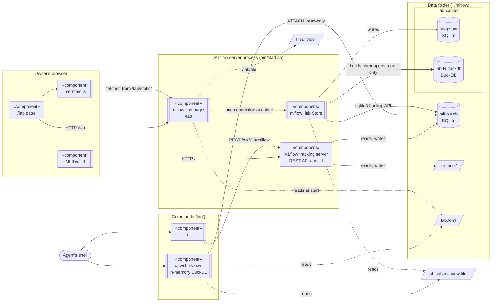

# mlflow-lab

Decisions, findings, protocol rules and open questions about experiments, kept as runs of a local
MLflow server next to the experiments' own runs. `q` answers questions about runs and records with
one DuckDB SQL query; `rec` adds and changes records; pages at `/lab` of the MLflow server show the
records with their evidence, the SQL views as tables, a read-only query box and the experiments'
files. It is meant for a coding agent and a person working on the same experiments: the agent reads
and writes with `q` and `rec`, the person reads the pages.

| Path | What it is |
|---|---|
| `mlflow_lab/` | the MLflow plugin that adds the `/lab` pages (`mlflow server --app-name lab`) |
| `mlflow_lab/lab.sql` | the views `runs` and `records`, which q and the pages query |
| `bin/start.sh` | starts the MLflow server with the pages |
| `bin/q` | runs SQL over the views and prints the rows as a table |
| `bin/rec` | adds or changes a record through MLflow's REST API |
| `bin/check_views.py`, `bin/sqlite_filter_bug.py` | checks to run before changing the DuckDB version |
| `plugin/` | a Claude Code plugin holding the skill `experiment-db`, which tells the agent how to use q and rec |

## Records

A record is an MLflow run named `<kind>: <title>`. Its text is the run's note, in Markdown, and its
tags are `record.id`, `record.kind` (decision, finding, protocol or question), `record.status`
(open, closed or superseded), `record.by`, `record.experiment` (a label), `record.answers` (the
question it answers) and `record.evidence`: items `mlflow:<run id>`, `file:<path>`,
`sql:<query over the views>` or `record:<id>`, joined by `; `. The view `records` has one row per
record. MLflow cuts a text longer than 8000 characters.

## Architecture



There is one database of record, `mlflow.db`; the others are read-only copies or views of it,
rebuilt from it when needed.

| Database | Engine | Where | Written by | Read by | Lasts |
|---|---|---|---|---|---|
| `mlflow.db` | SQLite | data folder | the MLflow server only (SQLAlchemy over Python's sqlite3); rec and the experiments' own logging go through its REST API | the MLflow server; q; the Store | always |
| snapshot | SQLite | data folder, `lab-cache/` | the Store, with SQLite's backup API | DuckDB, while it builds `lab-N.duckdb` | until that build ends |
| `lab-N.duckdb` | DuckDB | data folder, `lab-cache/` | the Store: MLflow's six tables copied into the schema `mlflow`, then the views | the `/lab` pages, read-only, with file access off | until `mlflow.db` or a view file changes; `lab-cache/` is emptied when the server starts |
| q's database | DuckDB, in memory | q's process | q: MLflow's six tables as views over `mlflow.db`, attached read-only, then the views | the SQL given to q | one q call |

DuckDB is the query engine; it never writes `mlflow.db`. It reads SQLite files through its own
copy of SQLite, which DuckDB downloads once as its `sqlite_scanner` extension into
`~/.duckdb/extensions/`. Two copies of SQLite in one process do not see each other's locks
(https://www.sqlite.org/howtocorrupt.html, section 2.2.1), so a DuckDB read inside the MLflow server
could see a write half done. That is why q, a separate process, attaches `mlflow.db` directly,
while the pages, inside the server, read a snapshot. `lab.sql` and the view files hold SQL text,
not data; `artifacts/` holds the files MLflow runs log.

## Setting up a computer

It needs Linux (start.sh uses `setsid` and `ionice`), [uv](https://docs.astral.sh/uv/), and network
access the first time q or the pages read the database, when DuckDB downloads its SQLite reader.

```sh
git clone https://github.com/dgutson/experiment-lab ~/mlflow-lab
uv tool install mlflow==3.16.1 --with-editable ~/mlflow-lab --python 3.12
~/mlflow-lab/bin/start.sh
MLFLOW_TRACKING_URI=http://127.0.0.1:5000 mlflow experiments create -n "my project"
~/mlflow-lab/bin/rec add question "Which sample rate do we keep?" --in "my project" --text "..."
~/mlflow-lab/bin/q "SELECT id, kind, status, title FROM records"
```

Then open http://127.0.0.1:5000/lab.

There is no schema to create: MLflow makes the tables of `mlflow.db` on its first start, and q and
the pages make the views each time they read. MLflow 3.16.1 is the version tested; the plugin uses
parts of MLflow's server that other versions may change.

For a Claude Code agent, install the plugin `mlflow-lab`:

```sh
claude plugin marketplace add dgutson/experiment-lab
claude plugin install mlflow-lab@mlflow-lab-marketplace
```

Its skill, `mlflow-lab:experiment-db`, runs `~/mlflow-lab/bin/q` and `~/mlflow-lab/bin/rec` from the
clone, so q reads the same `lab.sql` as the pages. With the clone elsewhere, link it:
`ln -s /path/to/clone ~/mlflow-lab`. The skill finds a project's views through `lab.toml`, so it
needs no editing. Eval cases for the plugin go in `plugin/evals/`; run them with
`claude plugin eval ~/mlflow-lab/plugin`.

## The data folder and lab.toml

The server's files are in the data folder, `$MLFLOW_LAB_DATA` (default `~/mlflow`): `mlflow.db`,
`artifacts/`, `server.log`, `lab.toml` and the pages' `lab-cache/`. Run one server per data folder. q reads the database in the same folder. start.sh uses
port `$MLFLOW_LAB_PORT` (default 5000); with another port, set `MLFLOW_TRACKING_URI` for rec.

`lab.toml` is optional:

```toml
# The folder /lab/file shows; nothing outside it is shown. Without it, there is no files page.
files = "~/experiments"
# The project's views, run after lab.sql, in this order.
views = ["~/experiments/views.sql"]
```

Paths may start with `~`; others are taken relative to the data folder. q reads lab.toml each time
it runs, the server when it starts. A change to a view file shows on the pages without a restart.

A view file holds DuckDB `CREATE VIEW` statements over `runs`, `records` and MLflow's tables in the
schema `mlflow` (`mlflow.runs`, `mlflow.tags`, `mlflow.params`, `mlflow.latest_metrics`,
`mlflow.experiments`). For example:

```sql
-- One row per finished run of "my project", with its accuracy.
CREATE VIEW accuracy AS SELECT name, metrics['accuracy'] AS accuracy
    FROM runs WHERE experiment = 'my project' AND status = 'FINISHED';
```

## Diagrams

Record texts and `.md` files are shown as Markdown, and their ```` ```mermaid ```` blocks are drawn
as diagrams in the browser by mermaid.js 11.17.2. The pages fetch it from the plugin itself
(`mlflow_lab/static/`, with its MIT license), so no diagram text leaves the computer and the server
needs no Node. 11.17.2 is the version mermaid-cli 11.16.0 uses, so `mmdc -i x.mmd -o x.svg` checks a
diagram the way the pages draw it. A diagram that does not parse shows Mermaid's error above its
text.

To change the version, take `package/dist/mermaid.min.js` and `package/LICENSE` from
`npm pack mermaid@VERSION`, store them as `mlflow_lab/static/mermaid-VERSION.min.js` and
`mermaid-VERSION.LICENSE`, and change the file name in `mlflow_lab/templates/lab/base.html`.

## Changing the DuckDB version

DuckDB is pinned in `pyproject.toml` and in the three scripts in `bin/`. Set the new version in
`check_views.py` and `sqlite_filter_bug.py` first and run both while nothing is logged to MLflow:

```sh
cd ~/mlflow-lab/bin && uv run --script check_views.py && uv run --script sqlite_filter_bug.py
```

check_views.py must end with "the two reads agree" and sqlite_filter_bug.py must say "fixed". Then
set the version in `q.py` and `pyproject.toml`, and reinstall:
`uv tool install mlflow==3.16.1 --with-editable ~/mlflow-lab --python 3.12 --reinstall-package mlflow-lab`.
